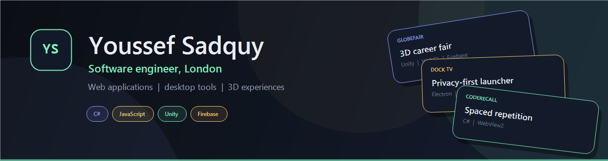

## About

Software engineer based in London with a first-class BSc in Software Engineering from the University of Leicester (79.72%). I build web applications, desktop tools and 3D experiences, and I have run my own e-commerce business.

I like projects that connect software to real things: a virtual career fair, a smart TV, a bus stop, a voting system. I care about systems that are understandable, tested and actually shipped.

**Currently:** building [CodeRecall](https://github.com/youssefsadquy/CodeRecall), an offline-first study app for software engineers, and open to software engineering, web and Unity roles.

## Currently building

### CodeRecall

**Relearn faster. Remember longer.**

[Repository](https://github.com/youssefsadquy/CodeRecall) · [Download for Windows](https://github.com/youssefsadquy/CodeRecall/releases/latest) · [Release notes](https://github.com/youssefsadquy/CodeRecall/releases)

CodeRecall is a Windows study app for engineers returning to code. It combines 214 hand-written cards with a personal study plan and an optional AI tutor, without accounts, cloud storage or telemetry.

- **Plan-aware study:** five questions about background, freshness, goals, interests and pace produce a focused deck order.
- **Built for recall:** SM-2-flavoured scheduling, lapses, daily new-card limits, weak-spot drills and cram sessions.
- **Local-first:** progress is JSON under `%LOCALAPPDATA%`, API keys use Windows DPAPI, and backups are portable.
- **Engineering:** C# 10, .NET 6, WebView2 and vanilla JavaScript in a single-file Windows executable. GitHub Actions checks every push and publishes tagged releases.
- **AI is optional:** works with a keyless free provider, OpenRouter, Groq, Gemini, Ollama or any OpenAI-compatible endpoint, and fully offline with AI off.

## Featured projects

### GlobeFair — a 3D career fair that runs in the browser

[Web version](https://github.com/youssefsadquy/globefair-web) · [Live demo](https://globefair-46eb2.web.app/) (password on request) · [University submission](https://github.com/youssefsadquy/globefair)

My longest and most complex project. It started as my University of Leicester final-year project and I later rebuilt it for the web: a 3D career fair where job seekers and businesses sign up, and businesses take booths, post listings, answer questions, see who applied and chat with candidates.

- **Two account types:** separate sign-up and dashboards for job seekers and businesses, on Firebase Authentication and Cloud Firestore, with CV and logo uploads in Firebase Storage.
- **Business tools:** booth selection, listings, candidate list, Q&A, booth analytics (visitors, unique visitors, applicants) and chat.
- **Engineering:** Unity's Firebase SDK does not support WebGL, so I wrote a platform-neutral Firebase layer (about 1,400 lines of C#) with a 17-function JavaScript bridge. The same gameplay code runs on desktop and in the browser.
- **Scale:** about 7,000 lines of C# and 360 lines of JavaScript, in four languages (English, Spanish, French, Italian).
- **Outcome:** the university version attracted interest from the University of Leicester's Career & Employability team.
- **Stack:** Unity, C#, Firebase (Auth, Firestore, Storage), WebGL, Firebase Hosting.

### Dock TV — a cleaner home screen for Samsung TVs

[Repository](https://github.com/youssefsadquy/dock-tv) · [Companion player](https://github.com/youssefsadquy/dock-tv-player)

A Windows app (Electron) that replaces the ad-filled home screen on Samsung smart TVs with a clean, customisable Dock, and walks you through switching off the TV's tracking.

- **Finds and backs up the TV** on the local network, and shows honestly whether the model has been tested.
- **Privacy clean-up with an undo log:** every setting's old value is recorded first, so one click restores it.
- **Live designer:** apps, HDMI inputs, weather, London bus times (TfL), prayer times, Spotify, night mode and photo backgrounds, with a preview of the real launcher.
- **Installs over the network:** builds and signs the app, creating the signing certificate automatically on 2018 to 2022 TVs.
- **Engineering:** 18 automated tests against a fake TV and a fake SDK, settings validation, and a design that keeps personal data out of the app and the repository.
- **Stack:** JavaScript, Electron, Tizen web apps, REST APIs. Tested end to end on a Samsung UE55NU7021.

## Other projects

| Project | What it is | Stack |
|---|---|---|
| [GEVS Online Voting App](https://github.com/youssefsadquy/GEVS-Online-Voting-App) | A general election voting system: voter registration, one vote per voter, an election commission dashboard and a public REST API. | JavaScript, HTML, CSS |
| [RefugEAP website](https://github.com/youssefsadquy/RefugEAP-website) | A Java web application with a MySQL database for events and blog pages, with a user manual and setup guide. | Java, MySQL |
| [Study Scheduler](https://github.com/youssefsadquy/Study-Scheduler) | Software engineering coursework: functional requirements, use cases, class diagrams and a weekly log. | UML, documentation |

## Skills

| | |
|---|---|
| **Languages** | JavaScript, Java, Python, C++, C#, SQL, HTML, CSS |
| **Web and apps** | Node.js, Electron, Spring (MVC), REST APIs, Firebase (Auth, Firestore, Storage), Android |
| **Games and 3D** | Unity: C# scripting, large 3D scenes, UI and scene management, asset integration |
| **AI integration** | OpenAI-compatible APIs, local Ollama, context and prompt design |
| **Data** | Python notebooks, data analytics and big data coursework |
| **E-commerce** | Shopify, WooCommerce, WordPress |
| **Tools** | Git, GitHub Actions, IntelliJ, PyCharm, MySQL Workbench |

## Experience

**Founder and director, Nero Label Limited.** Ran all aspects of the business alongside my degree: team leadership, planning and delivery.

**Freelance web developer.** Built custom websites and e-commerce stores for clients, from business portfolios to online shops.

## Get in touch

I am open to opportunities in software engineering, web development and Unity game development.

- Email: [youssefsadquy@gmail.com](mailto:youssefsadquy@gmail.com)
- LinkedIn: [Youssef Sadquy](https://uk.linkedin.com/in/youssef-sadquy)
